<div align="center">

  <!-- Self-Hosted Animated Cyber Telemetry Banner -->
  <a href="https://vishalx.vercel.app">
    
  </a>

  <br/>

  <!-- High-Contrast Action Buttons -->
  <p align="center">
    <a href="https://vishalx.vercel.app">
      
    </a>
    &nbsp;
    <a href="https://www.linkedin.com/in/vishall211/">
      
    </a>
    &nbsp;
    <a href="mailto:vishalsingh.works@outlook.com">
      
    </a>
    &nbsp;
    <a href="https://github.com/vishall211?tab=repositories">
      
    </a>
  </p>

</div>

---

### ⚡ At a Glance

```yaml
Engineer: Vishal Singh
Focus: Machine Learning & AI Systems
Locations: Chandigarh, India • Open to Global & Remote Roles
Core Competencies:
  - Predictive Machine Learning & Spatial-Temporal Modeling
  - Multimodal Generative AI (Neural Speech, Vision, LLM Orchestration)
  - Automated Telemetry Pipelines & Real-Time Data Streaming
  - Intelligent Cross-Platform Product Engineering (Flutter & FastAPI)
Philosophy: "Turn chaotic real-world data into predictive engines and intuitive software."
```

---

### 🚀 Core Engineering Capabilities

<table>
  <tr>
    <td width="50%" valign="top">
      <h3>🧠 Predictive ML &amp; Spatial Systems</h3>
      <p>Transforming sparse, dynamic sensor data and transit telemetry into real-time predictive models, spatial ETA estimators, and digital twins.</p>
      <p>
        
        
        
        
      </p>
    </td>
    <td width="50%" valign="top">
      <h3>🤖 Multimodal GenAI &amp; Audio-Visual</h3>
      <p>Architecting interactive AI systems that fuse large language models, synchronized neural speech synthesis (TTS), audio processing, and generative vision.</p>
      <p>
        
        
        
        
      </p>
    </td>
  </tr>
  <tr>
    <td width="50%" valign="top">
      <h3>📡 Automated Data Pipelines &amp; ETL</h3>
      <p>Engineering automated ingestion daemons, GTFS-RT streaming pipelines, and clean feature stores for continuous, high-volume real-world data.</p>
      <p>
        
        
        
        
      </p>
    </td>
    <td width="50%" valign="top">
      <h3>📱 Intelligent Product Engineering</h3>
      <p>Bridging heavy backend models with fast, reactive client interfaces (Flutter &amp; Web) and high-throughput microservices (FastAPI).</p>
      <p>
        
        
        
        
      </p>
    </td>
  </tr>
</table>

---

### 🛠️ Technical Universe & Tooling

<div align="center">

| Category | Technologies & Tools |
| :--- | :--- |
| **Languages** |      |
| **Data Science & ML** |      |
| **Generative AI & Audio** |     |
| **Engineering & Deployment** |      |

</div>

---

### 📊 GitHub Activity & Metrics

<div align="center">
  <a href="https://github.com/vishall211">
    
  </a>
  &nbsp;
  <a href="https://github.com/vishall211">
    
  </a>
</div>

---

### 📬 Connect & Collaborate

<div align="center">
  <p>
    <b>Interested in discussing Machine Learning, AI Systems, or potential roles?</b>
  </p>
  <p>
    <a href="https://vishalx.vercel.app">
      
    </a>
    &nbsp;&nbsp;
    <a href="https://www.linkedin.com/in/vishall211/">
      
    </a>
    &nbsp;&nbsp;
    <a href="mailto:vishalsingh.works@outlook.com">
      
    </a>
  </p>
  <p>
    <i>"Transforming chaotic telemetry into predictive decisions and creative ideas into intelligent software."</i>
  </p>
</div>
