  <!-- Modern Animated Header Card -->
  

   

  <!-- Clean Action Pills -->
  

    
    &nbsp;
    
    &nbsp;
    
    &nbsp;
    
  

---

### ✦ About Me

I am a **Software Engineer & Builder** who loves creating dependable, practical, and well-crafted software. I work across the stack—from building responsive mobile applications in Flutter and backend APIs in Python, to engineering automated data pipelines.

* 💻 **Software Engineering:** Writing clean, modular code with strong fundamentals in algorithms and system design.
* ⚡ **Backend &amp; APIs:** Building fast REST APIs and automated services using Python and FastAPI.
* 📱 **Mobile &amp; Web:** Creating cross-platform mobile apps with Flutter and Dart.
* 📊 **Data &amp; Automation:** Automating daily workflows, collecting live data streams, and building data tools.

---

### ✦ Featured Projects

<table>
  <tr>
    <!-- DTUMOS -->
    <td width="50%" valign="top" bgcolor="#090d16">
      

        
      

      <h3>🚌 <a href="https://github.com/vishall211/DTUMOS">DTUMOS</a></h3>
      
City bus arrival forecasting and passenger dwell-time prediction using sparse, real-world GPS tracking streams.

      

        
        
        
      

      

        <a href="https://github.com/vishall211/DTUMOS"><b>View Repository ➔</b></a>
      

    </td>

    <!-- VIBE STORYTELLING -->
    <td width="50%" valign="top" bgcolor="#090d16">
      

        
      

      <h3>🎨 <a href="https://github.com/vishall211/Vibe-Storytelling">Vibe Storytelling</a></h3>
      
Interactive mobile storybook app that turns voice or text prompts into illustrated stories with synchronized audio narration.

      

        
        
        
      

      

        <a href="https://github.com/vishall211/Vibe-Storytelling"><b>View Repository ➔</b></a>
      

    </td>
  </tr>

  <tr>
    <!-- DELHI BUS DATA AUTOMATION -->
    <td width="50%" valign="top" bgcolor="#090d16">
      

        
      

      <h3>📡 <a href="https://github.com/vishall211/Delhi-Bus-Data-Automation">Delhi Bus Data Automation</a></h3>
      
Automated daily pipeline that ingests, cleans, and compiles real-time GTFS transit telemetry from Delhi's bus fleet.

      

        
        
        
      

      

        <a href="https://github.com/vishall211/Delhi-Bus-Data-Automation"><b>View Repository ➔</b></a>
      

    </td>

    <!-- SABUDH 2026 -->
    <td width="50%" valign="top" bgcolor="#090d16">
      

        
      

      <h3>📊 <a href="https://github.com/vishall211/Sabudh-2026">Sabudh ML Pipelines</a></h3>
      
Production machine learning pipelines, exploratory analysis, and predictive models built during internship at Sabudh Foundation.

      

        
        
        
      

      

        <a href="https://github.com/vishall211/Sabudh-2026"><b>View Repository ➔</b></a>
      

    </td>
  </tr>
</table>

---

### ✦ Tech Stack

| Domain | Technologies |
| :--- | :--- |
| **Languages** |      |
| **Frameworks &amp; Tools** |      |
| **Data &amp; Libraries** |     |

---

  

    <b>Let's build something great together</b> 
    <a href="https://vishalx.vercel.app">Portfolio</a> &nbsp;•&nbsp;
    <a href="https://www.linkedin.com/in/vishall211/">LinkedIn</a> &nbsp;•&nbsp;
    <a href="mailto:vishalsingh.works@outlook.com">vishalsingh.works@outlook.com</a>
  

