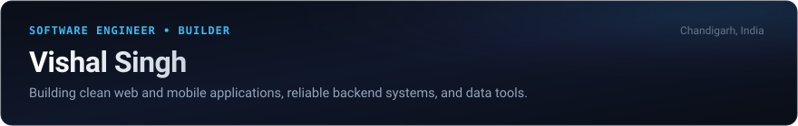

  <!-- Modern Clean Header Banner -->
  

   

  <!-- Clean Contact & Navigation Badges -->
  

    
    &nbsp;
    
    &nbsp;
    
    &nbsp;
    
  

---

### About Me

Hi, I'm **Vishal**. I am a **Software Engineer** who loves building useful, reliable, and well-designed digital products. 

I work across the software stack—from creating responsive mobile and web interfaces to designing dependable backend APIs and automating data pipelines. I focus on writing clean, readable code and turning practical ideas into working software.

* 💻 **Software Development:** Writing clean, modular code with strong fundamentals in algorithms and system design.
* ⚡ **Backend & APIs:** Building fast, reliable REST APIs and automated services with Python and FastAPI.
* 📱 **Mobile & Web:** Creating cross-platform mobile applications with Flutter and Dart.
* 📊 **Data & Automation:** Automating repetitive workflows, working with live data streams, and building data tools.
* 📍 **Location:** Chandigarh, India • Open to full-time roles and internships.

---

### What I Build

<table>
  <tr>
    <td width="50%" valign="top">
      <h3>💻 Web &amp; Mobile Apps</h3>
      
Building responsive, user-friendly mobile and web applications with clean architecture, smooth state management, and modern UI design.

      

        
        
        
      

    </td>
    <td width="50%" valign="top">
      <h3>⚡ Backend &amp; APIs</h3>
      
Designing fast, dependable backend services and REST APIs that connect databases, services, and client applications cleanly.

      

        
        
        
      

    </td>
  </tr>
  <tr>
    <td width="50%" valign="top">
      <h3>📊 Data &amp; Automation</h3>
      
Writing automated scripts and pipelines that collect, clean, and organize high-volume real-world data feeds like GPS transit telemetry.

      

        
        
        
      

    </td>
    <td width="50%" valign="top">
      <h3>🧠 Practical Machine Learning</h3>
      
Developing predictive models and intelligent features that solve real problems, from arrival time predictions to multimodal interactions.

      

        
        
        
      

    </td>
  </tr>
</table>

---

### Featured Projects

* **[Digital Twin for Urban Mobility](https://github.com/vishall211/Digital-Twin-for-Urban-Mobility-Systems):** Analyzes real-world city bus GPS data to identify traffic bottlenecks, estimate passenger boarding dwell times, and forecast bus arrivals.
* **[Vibe Storytelling](https://github.com/vishall211/Vibe-Storytelling):** An interactive mobile app that converts voice or text prompts into illustrated storybooks with synchronized voice narration and interactive pages.
* **[Delhi Bus Data Automation](https://github.com/vishall211/Delhi-Bus-Data-Automation):** An automated pipeline that collects, processes, and compiles daily real-time transit data from Delhi's bus network.
* **[Sabudh ML Workflows](https://github.com/vishall211/Sabudh-2026):** Production-grade data pipelines, predictive models, and analysis created during my Data Science Internship at Sabudh Foundation.

---

### Tech Stack

| Area | Technologies |
| :--- | :--- |
| **Languages** |      |
| **Frameworks & Tools** |      |
| **Data & Libraries** |     |

---

### GitHub Activity

  
  &nbsp;
  

---

  

    <b>Let's build something together</b> 
    <a href="https://vishalx.vercel.app">Portfolio</a> &nbsp;•&nbsp;
    <a href="https://www.linkedin.com/in/vishall211/">LinkedIn</a> &nbsp;•&nbsp;
    <a href="mailto:vishalsingh.works@outlook.com">vishalsingh.works@outlook.com</a>
  

