<div align="center">

<!-- Hero Terminal SVG Banner -->
<a href="https://vishalx.vercel.app">
  
</a>

<br/>
<br/>

<!-- Modern Pill Navigation -->
<p align="center">
  <a href="https://vishalx.vercel.app">
    
  </a>
  &nbsp;
  <a href="https://www.linkedin.com/in/vishall211/">
    
  </a>
  &nbsp;
  <a href="mailto:vishalsingh.works@outlook.com">
    
  </a>
  &nbsp;
  <a href="https://github.com/vishall211?tab=repositories">
    
  </a>
</p>

</div>

---

### 🎯 Recruiter & Tech Lead Quick-Scan

```yaml
Name: Vishal Singh
Focus: Machine Learning Engineer | Data Scientist | AI Systems
Specialization:
  - Spatial-Temporal Modeling & Urban Mobility Digital Twins
  - Automated Telemetry & GTFS-Realtime Data Engineering
  - Multimodal GenAI (Speech + Diffusion + Interactive Mobile)
Flagship Systems:
  - DTUMOS: Digital Twin for Public Transit Telemetry & Dwell Predictions
  - Vibe Storytelling: Multimodal Studio Ghibli AI Storybook (Flutter + GenAI)
  - Delhi Bus Automation: Daily Automated GTFS-RT Telemetry Pipeline
Current Location: Chandigarh, India (Available for Remote / Hybrid / Relocation)
Availability: Open to Full-Time & High-Impact Internship Opportunities
```

---

### 🚀 Flagship Engineering Deep Dives

<table>
  <!-- PROJECT 1: DTUMOS + DELHI BUS AUTOMATION -->
  <tr>
    <td colspan="2" bgcolor="#0d1117">
      <h3>
        🚌 <a href="https://github.com/vishall211/DTUMOS">DTUMOS</a> + 
        <a href="https://github.com/vishall211/Delhi-Bus-Data-Automation">Delhi-Bus-Data-Automation</a>
        &nbsp;
        
      </h3>
      <p><b>Digital Twin for Urban Mobility Systems & Real-Time Telemetry Pipeline</b></p>
      <p>
        Predicting bus arrival times and stop dwell times using sparse, low-frequency, jittery GPS transit data. Backed by an automated ingestion engine that compiles daily GTFS-Realtime telemetry streams from Delhi’s transit network.
      </p>
      <pre>
┌─────────────────────────┐    ┌──────────────────────────┐    ┌─────────────────────────┐
│ Delhi Open Transit API  │ ── │ Daily Automated ETL      │ ── │ DTUMOS Spatial Engine   │
│ (GTFS-RT Vehicle Pings) │    │ (Delhi-Bus-Automation)   │    │ (Dwell Time &amp; ETA Pred) │
└─────────────────────────┘    └──────────────────────────┘    └─────────────────────────┘
      </pre>
      <p>
        <b>Tech Stack:</b>
        <code>Python</code> • <code>Spatial Analytics</code> • <code>Scikit-Learn</code> • <code>Pandas</code> • <code>NumPy</code> • <code>Automated Telemetry Pipeline</code>
      </p>
      <p>
        🔗 <a href="https://github.com/vishall211/DTUMOS"><b>View DTUMOS Core Code</b></a> &nbsp;|&nbsp; 
        🔗 <a href="https://github.com/vishall211/Delhi-Bus-Data-Automation"><b>View Data Automation Pipeline</b></a>
      </p>
    </td>
  </tr>

  <!-- PROJECT 2: VIBE STORYTELLING -->
  <tr>
    <td width="50%" valign="top" bgcolor="#0d1117">
      <h3>
        🎨 <a href="https://github.com/vishall211/Vibe-Storytelling">Vibe Storytelling</a>
        &nbsp;
        
      </h3>
      <p><b>AI-Powered Interactive Multimodal Mobile Storybook</b></p>
      <p>
        Transforms spoken voice prompts or written ideas into illustrated Studio Ghibli–style storybooks with synchronized neural voice narration and interactive object detection.
      </p>
      <pre>
User Prompt (Voice/Text)
        ↓
Multimodal Narrative Engine
        ↓
Diffusion Art + Neural TTS
        ↓
Synchronized Flutter Book
      </pre>
      <p>
        <b>Tech Stack:</b>
        <code>Flutter</code> • <code>Dart</code> • <code>Multimodal GenAI</code> • <code>Neural TTS</code> • <code>Speech-to-Text</code>
      </p>
      <p>
        🔗 <a href="https://github.com/vishall211/Vibe-Storytelling"><b>Explore Vibe Storytelling</b></a>
      </p>
    </td>

    <!-- PROJECT 3: SABUDH 2026 -->
    <td width="50%" valign="top" bgcolor="#0d1117">
      <h3>
        📊 <a href="https://github.com/vishall211/Sabudh-2026">Sabudh ML Pipelines</a>
        &nbsp;
        
      </h3>
      <p><b>End-to-End Machine Learning & Analytics Pipeline</b></p>
      <p>
        Comprehensive production-grade codebase documenting exploratory data analysis, predictive modeling, statistical validation, and algorithmic workflows developed during Data Science Internship at Sabudh Foundation.
      </p>
      <pre>
Raw Telemetry &amp; Tabular Data
        ↓
Feature Store &amp; Drift Checks
        ↓
Model Tuning &amp; Validation
        ↓
Inference &amp; Performance Bench
      </pre>
      <p>
        <b>Tech Stack:</b>
        <code>Machine Learning</code> • <code>Python</code> • <code>EDA</code> • <code>Statistical Inference</code> • <code>Algorithms</code>
      </p>
      <p>
        🔗 <a href="https://github.com/vishall211/Sabudh-2026"><b>Explore Sabudh Workflows</b></a>
      </p>
    </td>
  </tr>
</table>

---

### 🛠️ Specialized Technical Capabilities

<div align="center">

| Domain | Core Competencies & Tools |
| :--- | :--- |
| **Languages & Systems** | `Python (Core)` • `SQL` • `Dart` • `C++` • `Shell / Bash` |
| **Data Science & ML** | `Scikit-Learn` • `Pandas` • `NumPy` • `Spatial-Temporal Modeling` • `Statistical Analysis` • `Matplotlib` • `Seaborn` |
| **Generative AI & Multimodal** | `Multimodal LLMs` • `Neural TTS & Whisper Audio` • `Image Diffusion Pipelines` • `Prompt Architecture` |
| **Engineering & Deployment** | `FastAPI` • `Flutter` • `Git / GitHub Actions` • `Automated Telemetry Pipelines` • `Docker Basics` • `Jupyter` |

</div>

---

### 📊 Engineering Activity & Telemetry

<div align="center">
  <a href="https://github.com/vishall211">
    
  </a>
  &nbsp;
  <a href="https://github.com/vishall211">
    
  </a>
</div>

<div align="center">
  <br/>
  <a href="https://github.com/vishall211">
    
  </a>
</div>

---

### 📬 Connect & Collaborate

<div align="center">
  <p>
    Whether you are looking to hire, discuss spatial-temporal AI, or build multimodal intelligent systems:
  </p>
  <p>
    <a href="https://vishalx.vercel.app">
      
    </a>
    &nbsp;&nbsp;
    <a href="https://www.linkedin.com/in/vishall211/">
      
    </a>
    &nbsp;&nbsp;
    <a href="mailto:vishalsingh.works@outlook.com">
      
    </a>
  </p>
  <p>
    <i>"Transforming complex telemetry into decisions and creative ideas into intelligent software."</i>
  </p>
</div>
