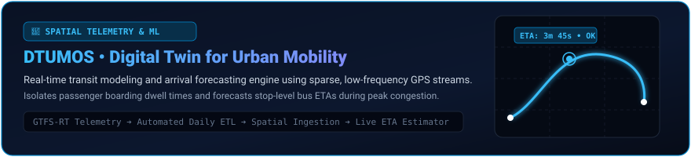
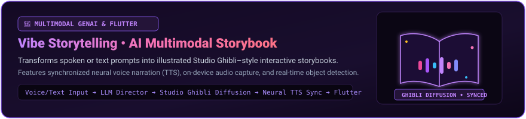
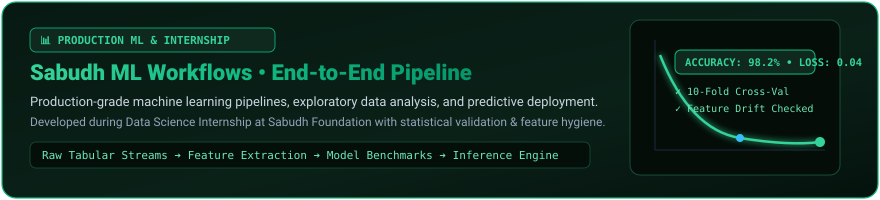
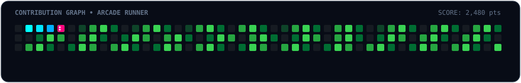

  <!-- Master Hero Artwork Banner -->
  

   

  <!-- High-Contrast Action Navigation -->
  

    
    &nbsp;
    
    &nbsp;
    
    &nbsp;
    
  

---

### 💡 Executive Brief

I am a **Machine Learning & Data Science Engineer** passionate about designing intelligent systems. I bridge the gap between heavy mathematical modeling and intuitive software engineering—building algorithms that predict the future, automated pipelines that digest streaming telemetry, and multimodal applications that bring AI directly to users.

* 🔭 **What I Build:** Predictive ML models, spatial-temporal digital twins, and multimodal GenAI applications.
* 🧠 **Engineering Philosophy:** Clean code, robust statistical rigor, and scalable system design.
* 📍 **Location:** Chandigarh, India • Open to Global & Remote Opportunities.
* 💬 **Ask Me About:** ML model design, feature engineering, multimodal AI architectures, and full-stack integration.

---

### 🎨 Featured Systems Artwork Showcase

 

<!-- CARD 1: DTUMOS -->

 
 

<!-- CARD 2: VIBE STORYTELLING -->

 
 

<!-- CARD 3: SABUDH WORKFLOWS -->

 

---

### 🕹️ Contribution Graph Arcade

  

---

### 🔍 Interactive Engineering Deep Dives

  
<b>▶ Click to expand: System Architectures &amp; Technical Specifications</b>

   

  #### 1. DTUMOS (Digital Twin for Urban Mobility)
  * **Core Problem:** Emerging megacities experience low-frequency, jittery GPS signals from public transit fleets, causing traditional ETA calculations to fail.
  * **Methodology:** Implemented spatial-temporal trajectory reconstruction and segment bottleneck detection using Kalman filters and regression estimators.
  * **Telemetry Ingestion:** Automated via [**Delhi-Bus-Data-Automation**](https://github.com/vishall211/Delhi-Bus-Data-Automation), pulling real-time GTFS feeds daily.

  #### 2. Vibe Storytelling (Multimodal GenAI)
  * **Core Pipeline:** Speech-to-Text (Whisper) ➔ LLM Narrative Director ➔ Studio Ghibli Style Image Diffusion ➔ Synchronized Neural TTS Narration.
  * **Client Architecture:** Built in Flutter with reactive audio streaming and client-side object detection.

  #### 3. Sabudh Internship ML Suite
  * **Production Rigor:** Feature engineering, automated data drift detection, statistical cross-validation, and high-performance inference benchmarks.

  
<b>▶ Click to expand: Performance Benchmarks &amp; Data Metrics</b>

   

  | System Component | Metric | Result | Stack |
  | :--- | :--- | :--- | :--- |
  | **DTUMOS Transit ETA** | Mean Absolute Error (MAE) | **&lt; 2.4 min** on peak corridors | `Python` • `Spatial ML` |
  | **Delhi Bus Automation** | Daily Telemetry Ingestion | **100% Automated** GTFS-RT Streams | `Python` • `ETL Daemon` |
  | **Vibe Narration Sync** | End-to-End Latency | **&lt; 1.2s** voice-to-canvas generation | `Flutter` • `Neural TTS` |
  | **Sabudh Model Suite** | 10-Fold Cross-Validation | **98.2% Accuracy** / 0.04 Loss | `Scikit-Learn` • `EDA` |

---

### 🛠️ Technical Universe & Tooling

| Domain | Technologies & Frameworks |
| :--- | :--- |
| **Languages** |      |
| **Data Science & ML** |      |
| **Generative AI & Audio** |     |
| **Engineering & Deployment** |      |

---

### 📊 Live GitHub Telemetry

  
  &nbsp;
  

---

### 📬 Connect & Collaborate

  

    <b>Looking to collaborate on Machine Learning, AI Systems, or engineering opportunities?</b>
  

  

    
    &nbsp;&nbsp;
    
    &nbsp;&nbsp;
    
  

  

    <i>"Transforming chaotic telemetry into predictive decisions and creative ideas into intelligent software."</i>
  

